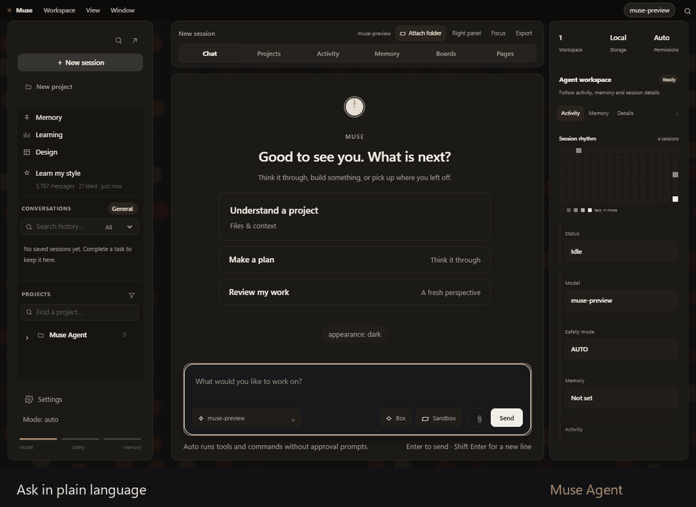
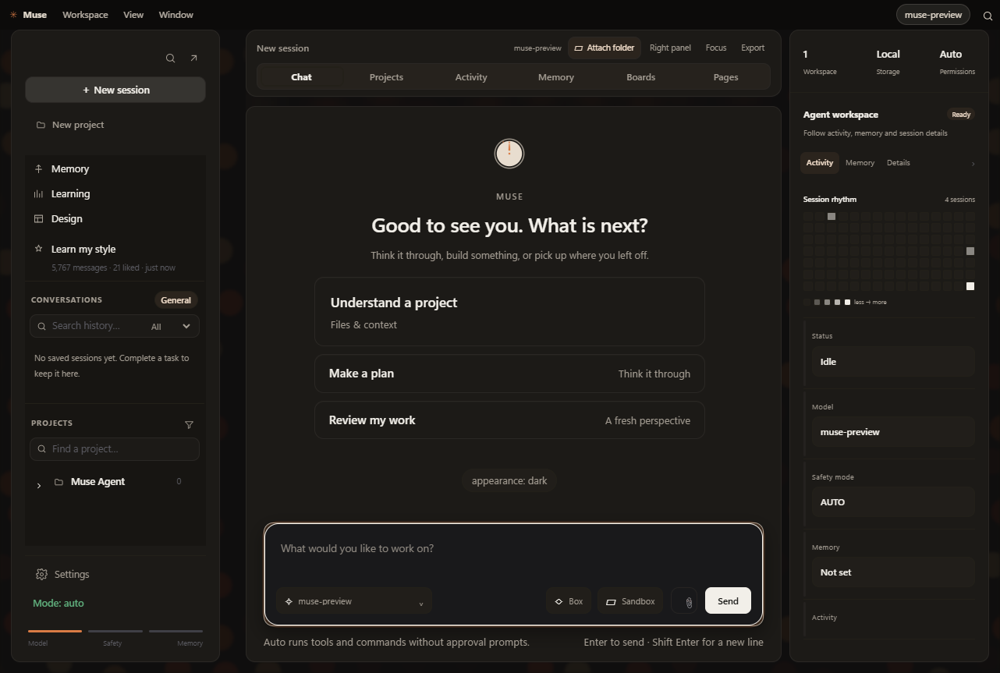
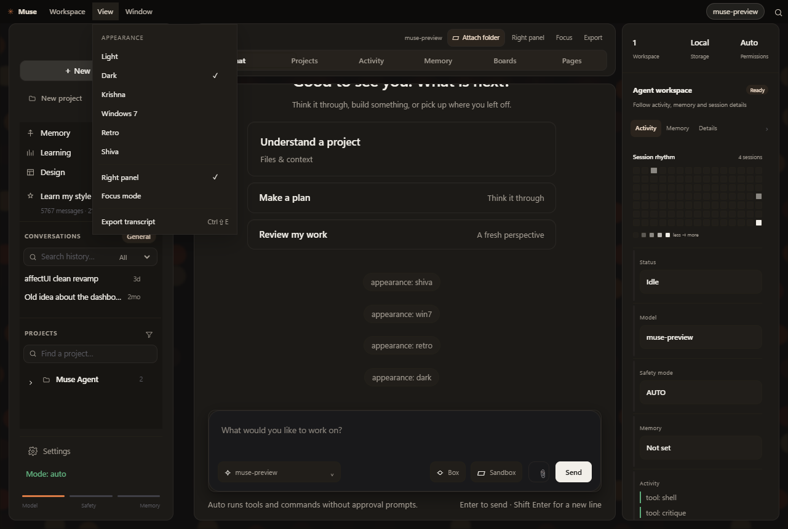
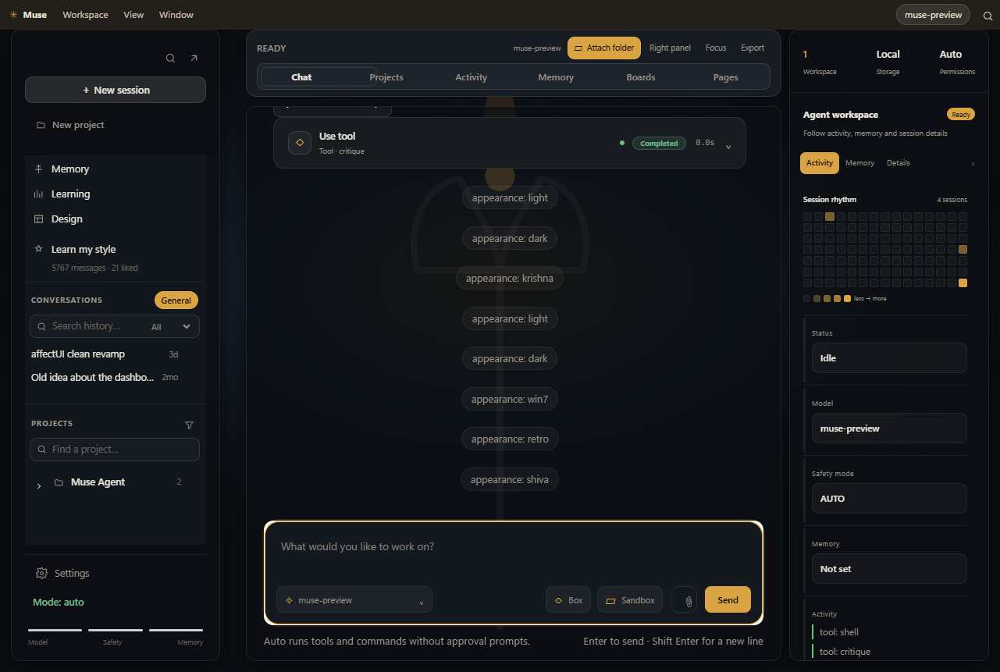
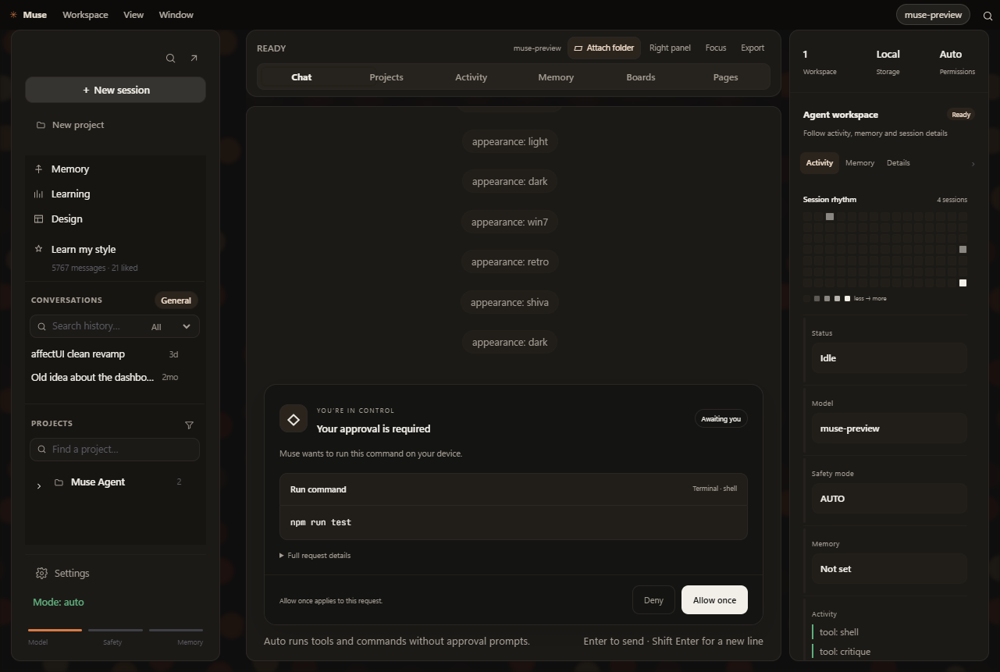
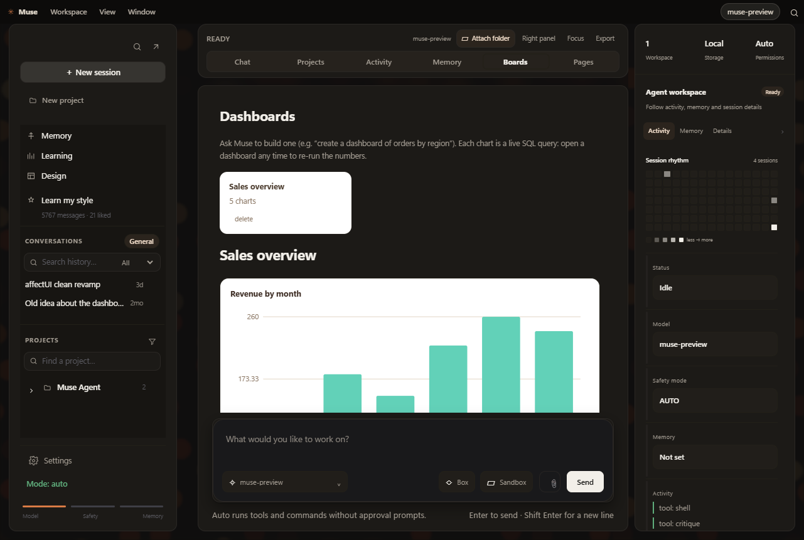
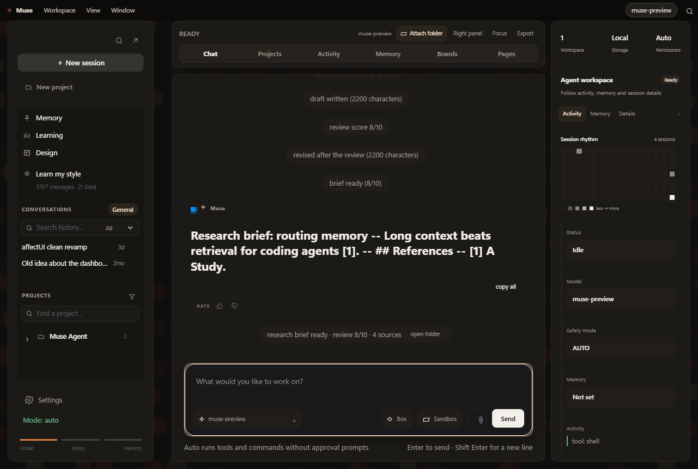
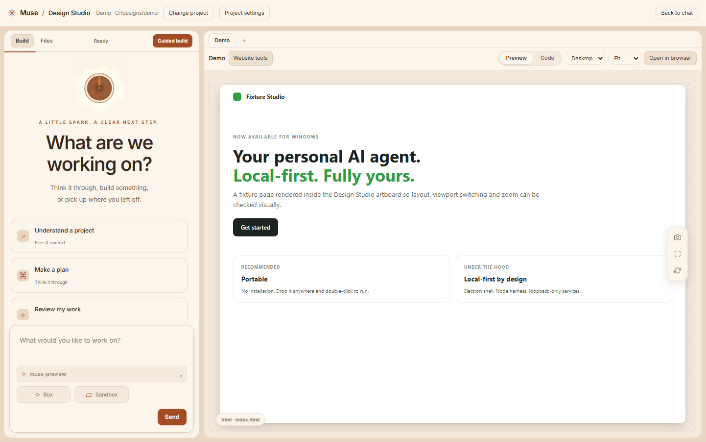

# Muse Agent

**A desktop AI agent that works on your machine, and shows its work.**

Muse reads your folders, runs commands, builds live dashboards, writes cited research, and keeps what it learns between sessions. It is an Electron app with a local agent harness: your files, sessions, memory and keys stay on your device, and the model is whichever endpoint you point it at.

[](https://github.com/CM71103/Muse-Agent/releases/latest)
[](https://github.com/CM71103/Muse-Agent/releases)
[](LICENSE)




> **What leaves your machine:** the model requests you trigger, and nothing else. A remote provider receives the conversation plus whatever files, tool results and recalled memories the turn needed. Point Muse at a local model server and inference stays on the device too.

---

## Start in three steps

### 1. Get the app

Windows, from [GitHub Releases](https://github.com/CM71103/Muse-Agent/releases/latest):

| Asset | What it is |
| --- | --- |
| `MuseAgent-<version>-portable.exe` | No install. Run it. |
| `Muse-Agent-Setup-<version>.exe` | Installer (NSIS). It also carries the auto-update payload. |

Keep the whole archive together if a release ships a ZIP, and run `Muse Agent.exe` inside it.

From source, you need **Node.js 24 or newer**, **Bun** and **Git**:

```powershell
git clone https://github.com/CM71103/Muse-Agent.git
cd Muse-Agent
bun install
bun run start
```

`bun run start` builds the local renderer bundles and opens Electron.

### 2. Point it at a model

Muse has no account of its own and ships no key. You bring a provider key: OpenAI, OpenRouter, Together, Groq, a local server, anything that speaks the OpenAI chat API. The app stores the key in the OS vault.

**Settings → Connection**: base URL, API key, model. Press **Fetch models**, pick the ones you want in the chat picker, tick **In chat**, then **Save connection**.


A model id can also be typed by hand. Fetching the list only proves the endpoint lists it; it does not promise the model can call tools.

**One key is enough for most people.** Leave the memory embedding fields empty and the embeddings ride the same endpoint and the same key as the chat. Fill them in only when you want embeddings from a different provider, for example a chat model on your own machine with embeddings from a hosted one.

| Key | When you need it | Where it is kept |
| --- | --- | --- |
| Chat key | Always, unless your endpoint needs none | OS vault (DPAPI on Windows, Keychain on macOS) |
| Embedding key | Only when the embedding endpoint differs from the chat one | OS vault, same place |

Neither key is written to `config.toml`, sent to the renderer, or put in a transcript. The app tells you only *whether* a key is saved, and shows a masked placeholder where you typed one.

For a terminal run, export the key for that session instead:

```powershell
$env:MUSE_LLM_API_KEY = "your-api-key"
bun run start
```

### 3. Give it a folder and a task

Select **New project**, name it, attach the folder you want it to work in. Then ask something concrete:

```text
Read the README and explain how this project is organized.
```

```text
Review the changes in this folder and identify likely bugs.
```

```text
Make a plan for adding search to this application before editing files.
```

---

## What it does

| Area | In practice |
| --- | --- |
| **Projects** | Group conversations, attach a working folder, give each project its own instructions. |
| **Files** | Explore directories, read source, write changes through the agent's tools. |
| **Commands** | Run shell commands and inspect the output, the status and the duration. |
| **Your data** | Register SQLite databases as read-only sources; the agent explores schemas and runs capped single SELECTs. |
| **Dashboards** | Ask in plain English. One SQL query per chart, re-run every time the dashboard opens. Bar, line, area, pie, stat, table. |
| **Visual pages** | Ask for a diagram, comparison, review or recap. Muse writes one self-contained HTML page and checks its own layout in a browser, instead of ASCII art. |
| **Your voice** | On first run Muse reads the AI conversations already on your machine and learns the shape of the answers you accept. Style metrics only, never the content. |
| **Research** | Search Semantic Scholar, OpenAlex and arXiv, read the papers that matter, and record every source against the claim it supports. |
| **Full briefs** | `/research <topic>` runs plan, search, read, draft, review, revise, and leaves a cited brief plus its citation map on disk. |
| **Self review** | A reviewer pass scores long output against explicit axes and returns ranked fixes. The agent applies them and stops when the score stops climbing. |
| **Models** | Search what your endpoint serves, choose which models are visible in chat, switch from the composer. |
| **Subagents** | Delegate a self-contained task and follow it in its own card, with its own status and result. |
| **Memory** | Project-scoped SQLite memory with embeddings, evidence versions, quarantine and grading. |
| **MCP** | Connect stdio MCP servers and their tools become available to the agent. |
| **Control** | Permission modes, approval requests, a real Stop button, and a queue you can reorder or cancel. |
| **Undo** | Every run snapshots the files it touches. One action restores them, skipping anything you edited afterwards. |
| **Attachments** | Drop a PDF or an image. Text is extracted locally, and pixels are sent only when the model can see them. |
| **Grading** | Mark an answer liked or disliked. The marker becomes a style rule, applied to the very next answer. |
| **Appearance** | Six looks, each with its own picture: Light, Dark, Krishna, Windows 7, Retro, Shiva. |

---

## The interface



A menu bar runs across the top: **Workspace**, **View**, **Window**. Every command in the app is one click from there, and the View menu is where the appearance is chosen.



A turn reads in the order it happened:

1. **Your request**, as a block with a rule down its left edge.
2. **The tools of that turn**, collected under one *Worked for N steps* disclosure. A finished step folds to a single line, a running one stays open, and a step you opened stays open.
3. **The answer**, as plain text under a small MUSE label.
4. **A files-changed card**, when the turn wrote anything, with the file names and one Undo action.

The composer is one container: the request on top, the controls underneath (attach, Box, Sandbox, the model, Stop, Send). Stop really stops: the running tool, the provider call and the queued messages all respect the cancel.

The rail on the right is an inspector. It shows the status, the model, the safety mode, the memory layer, and the live activity of the session.

### Six appearances, each with a picture



| Appearance | What it is |
| --- | --- |
| **Light** | The daylight palette, its own tokens, not an inverted dark theme. |
| **Dark** | The neutral workbench: hairline chrome, one accent, 13px type. |
| **Krishna** | Deep indigo and teal with gold. |
| **Windows 7** | The Aero light rays and glossy blue chrome. |
| **Retro** | An amber phosphor terminal: monospace, scanlines, a warm bloom. |
| **Shiva** | Ash, saffron and a trident on deep blue-black. |

The pictures are inline SVG, so the app stays offline and carries no image files. Pick one from **View → Appearance** or from the swatches in Settings; it persists across launches.

---

## Control

Change the mode from the sidebar. Every registered tool call passes through the Sentinel policy gate.

| Mode | File access | Commands and other actions |
| --- | --- | --- |
| **Ask** | Reads inside the granted project scope are automatic, anything else asks. | Side-effect tools need approval. |
| **Accept edits** | Project reads and in-project writes are automatic. | Shell and web actions still ask. |
| **Plan** | Read tools still respect the file scope. | Writes, shell commands and web actions are blocked. |
| **Auto** | Registered file tools can run anywhere, including outside the selected folder. | Tools, shell, MCP and delegation run without prompts. |

Deny rules apply in every mode, and unknown tools are rejected.



**Commands run with your Windows user permissions.** The approval gate is a policy check, not an operating-system sandbox. Read the command before you allow it.

Subagents share the parent's live permission policy while keeping their own model context, and a child agent cannot spawn further children.

---

## What Muse remembers

### Memory

Memory lives in SQLite next to the app, scoped per project. It stores scoped records with their metadata, retrieves them by embedding within a per-turn budget, captures durable preferences as they come up, and extracts useful facts at the end of a session. Records carry evidence versions, ranking controls, and quarantine for content a provider rejects.

Use `/good` or `/bad` to grade a memory-backed answer. Retrieved memories arrive as labelled context data, never as higher-priority instructions.

Embeddings use the chat endpoint and the chat key by default. Set a different endpoint, model or key in **Settings → Connection → Memory embeddings** when you want them somewhere else, and clear those fields to go back to the chat credential. A saved key shows as **Key saved** behind a masked placeholder, never handed back to the renderer.

### Your answer style

On first run Muse looks for AI conversations that already exist on your machine: a ChatGPT data export (`conversations.json`), ChatGPT caches, Claude Code transcripts (`~/.claude/projects`), Codex rollouts (`~/.codex/sessions`), Cline transcripts (`~/.cline/data/sessions`) and Muse's own sessions. It measures the answers you **accepted** against your average answer, and writes the difference into `~/.muse-agent/voice.md` as explicit rules.

The scan runs in a worker thread, so the window never freezes, and the rail shows what is known (for example `5,767 messages · 21 liked`). Where the liked answers disagree with your average, the liked answers win.

**Learn my style** in the sidebar (also in the command palette) re-reads every local chat, finds the accepted answers and rewrites the guide. The analysis is local and the guide stores style metrics and rules only: never quotes, topics or conversation content.

### Answer feedback

Grading an answer with 👍 or 👎 (or `/good` and `/bad`) writes an explicit marker to `~/.muse-agent/feedback.jsonl`: liked or disliked, plus the objective traits of that answer. Three liked short answers and two disliked hedged ones produce *keep answers tight* and *answer directly*. The rules join the style guide in the live session, so the next answer already matches.

The policy is deliberately slow: a rule needs at least two liked samples and a margin of two over the disliked ones, so one bad day cannot flip your agent's voice.

### A review before "done"

Long answers go through a reviewer first. The `critique` tool scores a draft on correctness, completeness, clarity, conciseness and tone fit (the last one checked against your learned style), and returns ranked weaknesses with concrete fixes. The agent applies them and critiques again only if the score is still low.

Every review is archived under `~/.muse-agent/reviews/<artifact>/`: `review_v1.json`, `review_v2.json`, and a `history.json` with the score of each round. That history is how the agent knows when to stop instead of churning the draft.

Point the reviewer at a different model if you want a stronger judge:

```toml
[llm]
model = "deepseek-chat"
review_model = "gpt-5"      # optional, empty means the same model as the writer
```

---

## What Muse produces

### Live dashboards over your own data



Register a SQLite database from the command palette (**Add SQLite data source**). Connections are read-only **at the driver level**: the agent physically cannot write, alter or run multi-statement SQL against them. Exploration queries are capped at 200 rows, dashboard queries at 10,000.

| Tool | What it does |
| --- | --- |
| `list_data_sources` | Lists registered connections with the ids the other tools take. |
| `sqlite_tables` | Schema exploration: tables, views and columns before any SQL. |
| `sqlite_run_sql` | One read-only SELECT, returned as `{columns, rows, truncated}`. |

Ask in plain English: *make a dashboard of orders by region with a bar chart and a pie chart*. Each chart is one SQL query stored **as a query, not as data**, so opening the dashboard re-runs every chart and the numbers are current. Six chart types render locally as SVG, with no chart library. A failed query becomes an error card on that chart and never breaks the dashboard.

### Visual pages

For anything a reader should grasp at a glance, Muse writes one self-contained HTML page: diagrams, comparisons, data tables, replays. The layout is checked in a real browser before the page is handed over, and the source sits beside the project files so it can be revised.

### Research briefs



```
/research long context versus retrieval for coding agents
```

The pipeline runs in public:

```
plan      the topic becomes 3-5 real search queries and a section outline
search    the scholarly indexes are queried, deduped and ranked
read      the papers that matter are read and each one gets notes
draft     the brief is written, citing [1] [2] markers
critique  a reviewer scores it (llm.review_model gets a different model)
revise    the fixes are applied, then it stops when the score stops climbing
```

Every stage streams into the transcript, and the run lands on disk:

```
~/.muse-agent/briefs/<topic>-<stamp>/brief.md        the brief, with a References section
                                        /sources.json   the citation map (source to claim)
                                        /notes.json     per-paper notes
                                        /outline.json   queries and section plan
                                        /run.json       stage receipts, resumable
```

The same pipeline runs from a terminal for scripting:

```powershell
node scripts/research-brief.mts "your topic" --goal "what should we adopt" --print
```

The CLI needs `MUSE_LLM_API_KEY` exported (a terminal cannot read the app's encrypted vault) and picks up `SEMANTIC_SCHOLAR_API_KEY` the same way.

### Research that cites its sources

Training data has a cut-off, so the model can be wrong about what the state of the art *is*. Three tools make it check instead of guess:

| Tool | What it returns |
| --- | --- |
| `search_papers` | A ranked list from OpenAlex, Semantic Scholar and arXiv: title, authors, year, venue, citation count, a one-line takeaway, an id. |
| `read_paper` | The full record for the hits that matter: abstract, DOI or arXiv id, link. |
| `cite_source` | The source recorded against the artifact you are writing: id, title, year, url, the exact claim it supports and a short quote. |

The citation map lives at `~/.muse-agent/research/artifacts/<name>/sources.json`. It says what the answer is based on, and it survives the session.

**No key is required.** OpenAlex leads the search, Semantic Scholar is consulted too, and arXiv adds preprints. Responses are cached for a day, so repeated searches cost nothing. A key makes it reliable when the shared pools are rate limited: paste it in **Settings → Workspace → Research & citations** and the main process writes it into the OS credential store, exactly like the chat key. It never sits in `config.toml`, never in the renderer, never in the transcript.

```toml
[research]
max_results = 6            # 1..10
cache_ttl_hours = 24
openalex_mailto = ""       # optional, for the polite pool
```

Failures are honest: results carry their year, so stale sources are visible; a missing abstract is reported as missing; an upstream error comes back as `{ok:false, code}` with `RATE_LIMITED`, `BLOCKED`, `NETWORK` or `EMPTY` rather than as a fake empty result.

### The Design Studio



**Design** in the sidebar opens a workspace for building things properly: a project folder, the design knowledge that shapes it, a live canvas, and the same conversation you use in chat.

Four registries feed it, scanned in the same order everywhere:

| Registry | Entry document | Supplies |
| --- | --- | --- |
| `design-systems/<id>/` | `DESIGN.md` | Tokens, type, spacing, behaviour, accessibility rules. |
| `design-templates/<id>/` | `TEMPLATE.md` plus starter files | A scaffolded starting point: landing page, deck, dashboard. |
| `skills/<id>/` | `SKILL.md` | A reusable procedure, such as a design review or an accessibility audit. |
| `craft/*.md` | the file itself | Brand-agnostic quality bars, on unless you pick a set. |

Roots are scanned **project → personal → bundled**, and the first hit wins, so a project overrides your personal copy and your personal copy overrides the shipped defaults. The personal root is `%MUSE_HOME%\design\` (or `~/.muse-agent\design\` by default). Bundled defaults: two design systems, three templates, eight skills (six of them the antislop rulebooks), two craft sets.

The three bundled templates ship guidelines, and the guidelines travel with the template:

| Template | What its guidelines pin down |
| --- | --- |
| `landing-page` | No invented customer counts or testimonials, 16px minimum type, 4.5:1 contrast, one CTA per section, mobile-first at 360px. |
| `deck` | One claim per slide, six lines of body text at most, five table rows at most, every number traceable. |
| `dashboard` | Units and period on every metric, missing data is `-` and not `0`, three distinct loading, empty and error states. |

Useful when a template is scaffolded:

```text
design_status                 the active project, selections, registry roots
design_registry              list or read registry entries
design_configure              set design system, skill, template, craft, name, kind
design_scaffold               copy a template's starter files into the project
design_artifact              validate and publish .od/artifact.json for the canvas
```

A project is an ordinary folder. Selecting one writes `.od/project.json` next to your files, so the folder stays usable on its own.

### The rulebook that ships with it

Six antislop rulebooks travel inside the app: the core filter, UI and visual, copy and text, people and accessibility (WCAG 2.2), layout and mobile, and code comments. Forty rules in three tiers, a purpose test for every visual decision, and a liveliness bar.

They are usable in three ways: as a skill in the Design Studio, as `/antislop` in chat for the current session, and as the house direction in `DESIGN.md` at the root of this repository. The rules are a filter, never a substitute for a project of its own.

```text
/antislop core       the forty rules
/antislop ui         the visual layer
/antislop all        every rulebook at once
/antislop off        leave the session as it was
```

---

## Where your data lives

| Item | Where |
| --- | --- |
| User configuration | `%MUSE_HOME%\config.toml` (by default `~\.muse-agent\config.toml`) |
| Credential vault | `credentials.enc` in the configuration directory |
| Sessions | `sessions\` in the configuration directory, one JSONL file each |
| Memory database | `memory\` in the configuration directory |
| Answer feedback | `feedback.jsonl` in the configuration directory |
| Answer-style guide | `voice.md` in the configuration directory |
| Research cache and artifacts | `research\cache\` and `research\artifacts\` |
| Review history | `reviews\<artifact>\` |
| Attachments | `attachments\` in the configuration directory |
| Alternate root | `MUSE_HOME` environment variable |
| Explicit config file | `MUSE_CONFIG` environment variable |

Keys saved through Settings use Electron's OS-backed encryption (DPAPI on Windows, Keychain on macOS). Older plaintext settings are migrated when the app loads. Environment variables still work for supplying a chat key.

The packaged app seeds its configuration from the bundled template on first run. Keep personal configuration out of git: [config.example.toml](config.example.toml) is the shareable reference, not a place for real keys.

**What is never written to web storage:** the renderer never touches it. Everything persists in files the app owns.

---

## Extending it

### MCP servers

**Settings → Integrations** adds a stdio server with its command, arguments and environment. Its tools appear as `mcp__<server>__<tool>` and follow the active permission mode. External servers run their own code: use the ones you trust.

### Command-line agent

The same harness without the window:

```powershell
bun run agent "Summarize this directory"
```

The terminal harness cannot read the desktop vault, so it takes credentials from the environment.

### Local host bridge

When enabled, the bridge exposes `/send`, `/status`, `/sessions`, `/cancel` and `/reset` on `127.0.0.1`. Requests need the bearer token stored as `bridge_token` in the configuration directory. It drives the running app. See the `[bridge]` section of [config.example.toml](config.example.toml).

### Box cloud desktop

**Settings → Integrations → Box by Simular → Connect Box** signs you in through the browser; no API key is pasted into chat. The **Box** button beside the model picker opens a panel with the connection state, recent tool activity and the latest returned screenshot. Box runs a cloud Linux desktop, separate from your Windows machine. After a private-file read, the egress policy can block remote Box calls unless `mcp.box.simular.ai` is in `sentinel.egress_allowlist`. Screenshot bytes go to the next model request and are not kept in session history or memory.

### Ubuntu sandbox

The **Sandbox** button beside the model picker opens an Ubuntu desktop inside Muse, with Oracle VirtualBox installed. Pick an ISO, **Create VM**, **Start**: the guest screen appears in the panel and takes mouse and keyboard input (printable ASCII, F6 returns focus to Muse). The VM gets 3 GB of RAM, two CPUs and a dynamically allocated 24 GB disk, with NAT networking. Shared folders, clipboard and drag-and-drop are not enabled, and your WSL distributions are separate. **Save clean desktop** stores a snapshot, **Reset to clean** restores it, **Stop & save** keeps the running state.

While the sandbox is the selected target, the agent receives only guest screen and input tools: host shell, file, Windows desktop, MCP and subagent tools are unavailable until you switch back with **Use host tools**.

---

## Build from source

```powershell
bun install
bun run start              # run it
bun run test               # the test suite
```

### Windows executables

```powershell
bun run dist:portable      # portable executable
bun run dist:dir           # unpacked application folder
bun run dist               # installer and portable
```

Output lands in:

```text
%LOCALAPPDATA%\MuseAgent\releases\<version>\
```

For 0.1.8 that folder holds:

| File | Purpose |
| --- | --- |
| `Muse-Agent-Setup-0.1.8.exe` | NSIS installer (auto-update payload) |
| `Muse-Agent-Setup-0.1.8.exe.blockmap` | Differential-download block map |
| `MuseAgent-0.1.8-portable.exe` | Portable executable |
| `latest.yml` | Update manifest, generated from the installer beside it |
| `win-unpacked/` | Unpacked application folder |

The output directory is not a preference. An executable built inside a Windows Low-integrity-labelled directory inherits restricted write access and fails when it needs the Temp folder, so the build wrapper stages releases in the per-user directory without changing the project's security labels.

Artifact names carry no spaces on purpose: `latest.yml` refers to the installer by URL, and a spaced filename is a classic source of updater failures. Rename an artifact by hand and you must regenerate `latest.yml`.

### Check before you publish

```powershell
bun run test                      # the suite
bun run release:check             # tests, native SQLite, package contents, ASAR integrity
bun scripts/verify-portable.mts   # launches the real portable executable under a probe
bun scripts/verify-settings.mts   # UI checks, writes screenshots into dist
bun scripts/verify-chat.mts
bun scripts/verify-design.mts
```

`release:check` builds into `dist/release-check` and writes a receipt only after the checks pass. The receipt records source hashes, Git state and package hashes. The visual scripts use an isolated preview bridge, so they never touch your real configuration or credentials.

### Publish a release

```powershell
$version = (Get-Content package.json -Raw | ConvertFrom-Json).version
$release = Join-Path $env:LOCALAPPDATA "MuseAgent\releases\$version"

gh release create "v$version" `
    (Join-Path $release "Muse-Agent-Setup-$version.exe") `
    (Join-Path $release "Muse-Agent-Setup-$version.exe.blockmap") `
    (Join-Path $release "latest.yml") `
    (Join-Path $release "MuseAgent-$version-portable.exe") `
    --repo CM71103/Muse-Agent `
    --target main `
    --title "Muse Agent v$version" `
    --generate-notes `
    --latest
```

Everything after the tag in `gh release create` is an asset path, which is why the title is passed with `--title`: a title in that position would be read as a file name.

The update check is notify-only by design. Muse asks the GitHub Releases API whether a newer tag exists, shows the notes and opens the release page in your browser when you click. Nothing is downloaded or replaced in place, because the portable executable is often file-locked by Windows.

Use a new version and a new tag for every release.

### Electron fuses

`build.electronFuses` in `package.json` hardens every packaged executable:

| Fuse | State | Why |
| --- | --- | --- |
| `enableNodeCliInspectArguments` | off | Blocks `--inspect` and `SIGUSR1` debugging of the main process. |
| `enableNodeOptionsEnvironmentVariable` | off | Blocks `NODE_OPTIONS` injection. Nothing in the app reads it. |
| `enableEmbeddedAsarIntegrityValidation` | on | The executable embeds the ASAR header hash and refuses a tampered `app.asar`. |
| `runAsNode` | on | `release-check` and `verify-portable` probe the packaged binary as Node. Turning it off also disables `process.fork` from the main process. |
| `onlyLoadAppFromAsar` | off | The site packager ships an unpacked `resources/app` folder, which this fuse would reject. |

Two fuses are deliberately left open. Closing `runAsNode` means moving the packaged smoke probes onto a different entry point first.

---

## Troubleshooting

| Symptom | What to check |
| --- | --- |
| **NSIS: error writing temporary file** | Build into the per-user release folder. A copy inside a Low-integrity-labelled directory inherits restrictions that block Temp writes. |
| **The embedding key looks empty** | Look for **Key saved** and the masked placeholder. Saved keys are deliberately not filled back into the field. |
| **A model is missing from chat** | Fetch or enter it in Settings, tick **In chat**, save the connection. |
| **Responses are slow** | Check the model and endpoint, the tool durations, memory availability and any retry errors. A finished shell command is usually followed by another model request. |
| **A tool was denied** | Check the mode, the project scope and the deny rules. Auto does not override deny rules. |
| **Native SQLite fails to load** | Run `bun run rebuild:electron` and rebuild the app. |
| **An update is waiting** | Download it from GitHub Releases. Muse points at updates, it does not replace the running app. |

---

## Project map

```text
app/
  main/                 Electron lifecycle, IPC, settings, the credential vault
  renderer/             Chat, projects, dashboards, charts, model pickers, activity, themes
  harness/              Model loop, tools, Sentinel, sessions, data sources, research, CLI, MCP
  memory/               SQLite memory, retrieval, extraction, feedback
  design/               Design systems, templates, skills and craft rules
build/                  Application icon and branding
scripts/
  renderer/             TypeScript sources for the local browser bundles
  test/                 Packaging and release-check tests
  build-windows.mts     Windows release output and the builder wrapper
  release-check.mts     Reproducible package validation
  verify-portable.mts   Launches the packaged binary and probes it
docs/                   Integration notes and UI preview images
DESIGN.md               The interface direction: identity, tokens, mood
AGENTS.md               How to work in this repository
config.example.toml     Configuration reference
```

## Contributing

Small, focused changes are welcome. Describe the behavior you are changing, keep personal configuration out of the diff, and run the checks that cover it. `AGENTS.md` explains the layout, the pinned test contracts and the rules that do not bend (the vault holds secrets, the renderer never touches web storage, the policy gate fails closed).

## License

MIT. See [LICENSE](LICENSE).
