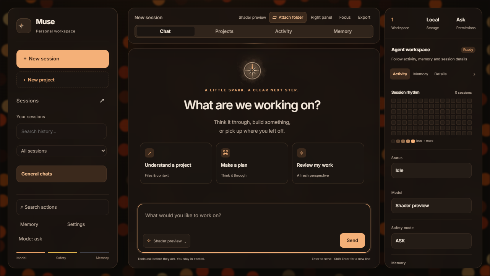
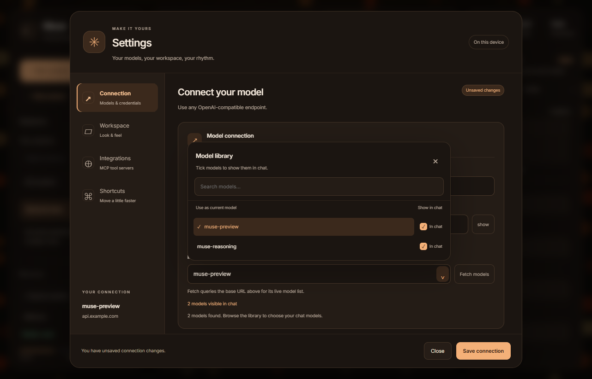
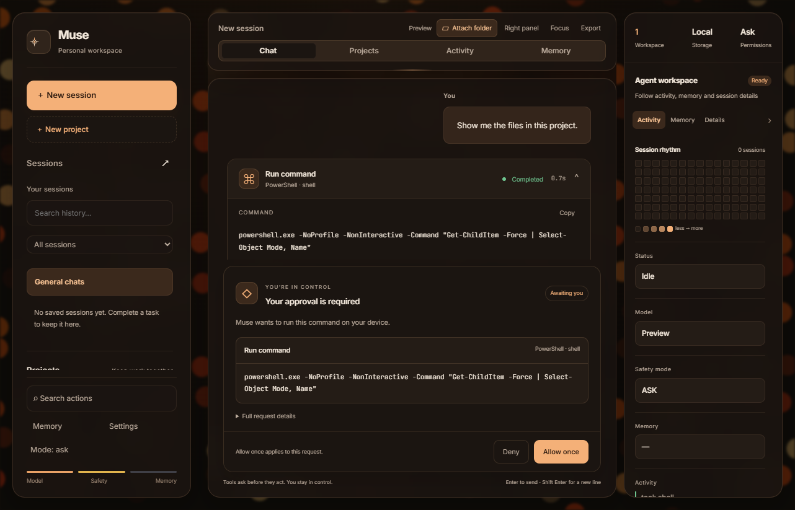

# Muse Agent

### A little spark. A clear next step.

A local-first desktop AI agent for understanding projects, working with files, and getting things done. Bring an OpenAI-compatible model endpoint, choose how much control to give the agent, and work from one focused workspace.

[](https://github.com/CM71103/Muse-Agent/releases/latest)
[](https://github.com/CM71103/Muse-Agent/releases)
[](#license)

[Download](https://github.com/CM71103/Muse-Agent/releases/latest) · [Get started](#get-started) · [Features](#what-you-can-do) · [Build](#build-for-windows) · [Troubleshooting](#troubleshooting)



> **Local-first, with your choice of model.** The desktop app, project files, sessions, and memory live on your machine. Model requests go to the endpoint you configure; using a remote provider sends it the conversation and any tool results or recalled context included in the request. A local model server can keep inference on your machine too.

---

## What you can do

| Capability | In practice |
| --- | --- |
| **Work with projects** | Group conversations, attach a working folder, and give each project shared instructions. |
| **Read and change files** | Explore directories, inspect source, and write changes through the agent's tools. |
| **Run commands** | Execute shell commands and inspect readable output, completion status, and duration. |
| **Choose your models** | Search available models in Settings, select the ones visible in chat, and switch from the composer. |
| **Delegate work** | Follow subagents through individual cards with their task, activity, status, and result. |
| **Recall useful context** | Enable project-scoped memory backed by SQLite and embeddings, with feedback and memory-management controls. |
| **Extend the toolkit** | Connect MCP servers over stdio and make their tools available to the agent. |
| **Stay in control** | Choose a permission mode, review approval requests, and stop a running task. |
| **Make it yours** | Switch between light and dark themes, adjust glass opacity, and toggle the animated shader background. |

### Built for a continuous workflow

- **Readable activity:** commands and results have their own cards, with Copy buttons and expandable request details.
- **Long conversations:** automatic context compaction summarizes older history; `/compact` requests compaction explicitly.
- **Persistent sessions:** reopen previous conversations from the sidebar or project workspace.
- **Visible delegation:** child-agent completion does not prematurely finish the parent agent's running state.
- **Desktop presence:** tray controls and notifications surface work and approval requests.
- **Update notifications:** Muse checks GitHub Releases and points you to available updates; it does not silently replace the running app.

## Get started

### Option A: download the Windows app

1. Open [GitHub Releases](https://github.com/CM71103/Muse-Agent/releases/latest).
2. Download `MuseAgent-<version>-portable.exe` when that asset is available.
3. Run the portable executable. Installation is not required.
4. Open **Settings → Connection** and configure your endpoint, API key, and model.

Release assets vary. If an installer is provided, `Muse Agent Setup <version>.exe` installs the app with shortcuts. If a Windows ZIP is provided, extract the **entire archive** and run `Muse Agent.exe` inside it; keep its accompanying folders and files together.

### Option B: run from source

You need **Node.js 24 or newer**, **Bun**, and **Git**. You also need access to an OpenAI-compatible model endpoint; authentication requirements depend on that endpoint.

Run in PowerShell:

```powershell
git clone https://github.com/CM71103/Muse-Agent.git
cd Muse-Agent
bun install
bun run start
```

The start command builds the local renderer bundles before opening Electron.

You can enter your key in Settings or provide an environment variable for the current terminal session:

```powershell
$env:MUSE_LLM_API_KEY = "your-api-key"
bun run start
```

### Connect your first model

1. Open **Settings → Connection**.
2. Enter your provider's **Base URL** and **API key**.
3. Select **Fetch models**, then open the model dropdown.
4. Choose a model to use, or enter its ID manually.
5. Tick **In chat** for each model you want in the chat picker.
6. Select **Save connection**.

The model picker in the chat box shows your saved selections. Switching models keeps your conversation and unsent message. Switching is blocked while the agent is working or waiting for an approval.



The library can also include a manually entered model ID. Fetching models checks the endpoint's model-list API; it does not guarantee that every listed model supports the tool calls your task needs.

### Start a project

Select **New project**, give it a name, and attach a folder when you want the agent to work with local files. Add goals or conventions in **Project settings** to share them across the project's conversations.

Try a concrete request:

```text
Read the README and explain how this project is organized.
```

```text
Review the changes in this folder and identify likely bugs.
```

```text
Make a plan for adding search to this application before editing files.
```

## Permission modes

Change the active mode from the sidebar. All registered tool calls pass through the Sentinel policy gate.

| Mode | File access | Commands and other actions |
| --- | --- | --- |
| **Ask** | Reads within the granted project scope are automatic; access outside it asks. | Side-effect tools require approval. |
| **Accept edits** | Project reads and in-project writes are automatic; other file access follows approval rules. | Shell and web actions still ask. |
| **Plan** | Read tools remain subject to file-scope checks. | Writes, shell commands, and web actions are blocked. |
| **Auto** | Registered file tools can run without approval, including outside the selected folder. | Registered tools, shell commands, MCP tools, and delegation run without approval prompts. |

Deny rules still apply in every mode, and unknown tools are rejected. Legacy `always_ask_tools` settings do not override Auto.



**Commands run with your Windows user permissions.** The approval gate is not an operating-system sandbox. Review commands and choose the mode that fits the work you are authorizing.

Subagents share the parent's live permission policy, while keeping separate model context. Child agents cannot spawn further children.

## Memory that follows your work

Memory is enabled in the example configuration. Automatic project memory becomes active when a project folder supplies a scope; without a project scope, automatic capture and retrieval stay suspended. Explicit personal or manual scopes are available through the memory controls.

The memory layer provides:

- SQLite storage for scoped memories and their metadata.
- Embedding-based retrieval within a per-turn context budget.
- Selective capture of durable preferences and facts.
- Session-end extraction of useful information from collected events.
- Evidence versions, adaptive ranking controls, and quarantine for suspicious content.
- Inspection, grading, export, and deletion through the Memory drawer.

Use `/good` or `/bad` to grade the most recent eligible memory-backed response. Retrieved memories are supplied as labelled context data, not as higher-priority instructions.

### Embedding configuration

Chat and embeddings can use different endpoints and credentials. In **Settings → Connection → Memory embeddings**, set a separate embedding URL, model, and key when your chat endpoint does not provide embeddings.

A saved embedding key is reused automatically. The field displays a masked placeholder and **Key saved** rather than returning the secret to the renderer. Leave it unchanged to keep the saved key; type a new value only to replace it, then save.

Post-answer capture stores pending memories locally without waiting for another embedding-provider request. Pending embeddings are processed during a later retrieval. Embedding or provider failures can still affect retrieval time; the app surfaces recoverable memory errors and can continue without recalled context.

## Configuration and data

| Item | Default location or control |
| --- | --- |
| User configuration | `$HOME\.muse-agent\config.toml` |
| Credential vault | `credentials.enc` inside the Muse configuration directory |
| Memory database files | `memory` inside the Muse configuration directory |
| Configuration reference | [config.example.toml](config.example.toml) |
| Alternate data directory | `MUSE_HOME` environment variable |
| Explicit configuration file | `MUSE_CONFIG` environment variable |

The packaged app seeds its user configuration from the bundled template on first run. Source development can also use a project-local `config.toml`.

Keys saved through Settings use Electron's OS-backed credential encryption. Existing plaintext key settings are migrated by the desktop configuration loader. Environment variables remain available for supplying chat credentials.

Keep credentials and personal configuration out of Git. `config.example.toml` is the shareable template, not a place for real API keys.

## Integrations and terminal use

### MCP servers

Open **Settings → Integrations** to add a stdio MCP server, its command, arguments, and environment settings. Server tools are exposed with names such as `mcp__server__tool` and follow the active permission mode.

External MCP servers run their own code. Use servers you trust and configure only the access they need.

### Command-line agent

Run the same harness without the desktop window:

```powershell
bun run agent "Summarize this directory"
```

Supply credentials through the environment when using the CLI; the terminal harness does not decrypt the desktop credential vault.

### Local host bridge

When enabled, the host bridge exposes `/send`, `/status`, `/sessions`, `/cancel`, and `/reset` on `127.0.0.1`. Requests require its bearer token, stored as `bridge_token` in the configuration directory. The bridge controls the live app instance.

See the `[bridge]` section in [config.example.toml](config.example.toml) for port and enablement settings.

## Build for Windows

Run from the repository root:

```powershell
# Portable executable
bun run dist:portable

# Unpacked application folder
bun run dist:dir

# Installer and portable targets
bun run dist
```

User-facing builds are written to:

```text
%LOCALAPPDATA%\MuseAgent\releases\<version>\
```

For example, the portable build is named `MuseAgent-0.1.7-portable.exe` for version `0.1.7`. The unpacked app lives under `win-unpacked` in the same release directory.

This output location matters: executables built inside a Windows Low-integrity-labelled directory inherit restricted write access and can fail when using the normal Temp folder. The Windows build wrapper stages releases in the per-user release directory without changing the project's security labels.

### Validate before publishing

```powershell
# Automated tests
bun run test

# Tests, native SQLite, package contents, and executable/ASAR integrity
bun run release:check

# Launch the actual portable EXE with an isolated runtime probe
bun scripts/verify-portable.mts
```

`release:check` uses `dist/release-check` for its validation build and writes a receipt only after successful checks. The receipt records source hashes, Git state, and package hashes. It does not replace a portable-launch or visual UI check.

The portable probe launches the release executable, checks packaged source files and SQLite, and verifies Temp writes without loading your real agent configuration or credentials.

Additional native UI checks are available:

```powershell
bun scripts/verify-settings.mts
bun scripts/verify-activity.mts
bun scripts/verify-shader.mts
```

These use an isolated preview bridge and generate screenshots under `dist`. The README images are preview captures with example data.

### Publish a GitHub release

After reviewing, committing, and pushing your release changes to `main`, use the GitHub CLI to upload the verified portable executable:

```powershell
$version = (Get-Content package.json -Raw | ConvertFrom-Json).version
$exe = Join-Path $env:LOCALAPPDATA "MuseAgent\releases\$version\MuseAgent-$version-portable.exe"

gh release create "v$version" "$exe" `
    --repo CM71103/Muse-Agent `
    --target main `
    --title "Muse Agent v$version" `
    --generate-notes `
    --latest
```

Use a new version and tag for each new release. Build and verify the matching executable before uploading it.

## Troubleshooting

| Symptom | What to check |
| --- | --- |
| **NSIS: Error writing temporary file** | Use the release from the per-user output folder above. A copy inside a Low-integrity-labelled project directory can inherit restrictions that prevent Temp writes. |
| **Embedding key looks empty** | Look for **Key saved** and the masked placeholder. Saved keys are intentionally not filled back into the input. |
| **Model missing from chat** | Fetch or enter the model in Settings, tick **In chat**, and save the connection. |
| **Slow responses** | Check the selected model and endpoint, tool duration, memory/embedding availability, and retry errors. A completed shell command may still be followed by another model request. |
| **A tool is denied** | Check the active mode, project scope, and deny rules. Auto does not override deny rules. |
| **Native SQLite fails to load** | Run `bun run rebuild:electron` for the desktop runtime and rebuild the app. |
| **An update is available** | Download the new asset from GitHub Releases. Update notifications do not automatically install it. |

## Project map

```text
app/
  main/                 Electron lifecycle, IPC, settings, credentials
  renderer/             Chat, projects, model pickers, activity, themes
  harness/              Model loop, tools, Sentinel, sessions, CLI, MCP
  memory/               SQLite memory, retrieval, extraction, feedback
build/                   Application icon and branding
scripts/
  renderer/             TypeScript sources for local browser bundles
  test/                 Packaging and release-check tests
  build-windows.mts     Windows release output and builder wrapper
  release-check.mts     Reproducible package validation
  verify-portable.mts   Actual launcher and runtime verification
docs/                    Integration notes and UI preview images
config.example.toml      Configuration reference
```

## Contributing

Small, focused improvements are welcome. Describe the behavior you are changing, keep personal configuration out of the diff, and include the checks relevant to the change.

For development, start with `bun run start`. Run `bun run test` for code changes, and use the native preview checks when changing the interface. For distributable Windows changes, also run the package and portable-launch checks.

## License

The project declares **MIT** in [package.json](package.json). A standalone license text is not currently included in the repository.
