<div align="center">



[](../../releases)
[](LICENSE)
[](../../releases)
[](#)

Electron shell · Node agent harness · Python hands sidecar

No cloud relay · No telemetry · No account · Your key stays local

[Features](#-what-it-does) · [Quick Start](#-quick-start) · [Security](#-security-model) · [Downloads](#-downloads) · [License](#-license)

<a href="https://github.com/CM71103/Muse-Agent"></a>

<a href="https://github.com/CM71103/Muse-Agent/pulse"></a>
<a href="https://github.com/CM71103/Muse-Agent/graphs/contributors"></a>


</div>

---

## What it does

Muse Agent is a local-first desktop agent. You talk to it; it reads files, runs
commands, fetches the web, controls the mouse and keyboard — **only after you
approve each action**.

| Layer | What it is |
|---|---|
| **Electron shell** | Chat window, approval dialogs, settings. Thin by design. |
| **Agent harness (Node)** | OpenAI-compatible LLM loop with tools: `shell`, `read_file`, `write_file`, `list_dir`, `web_fetch`, `hands`, `spawn_agent`. Every call passes the **Sentinel** gate first. |
| **Hands sidecar (Python)** | Screenshot / mouse / keyboard on `127.0.0.1:8788`, bearer-token auth, off by default. |

### Highlights

- **Sentinel approval gate** — deny-rule globs short-circuit dangerous calls;
  side-effect tools always ask; after reading local files, `web_fetch` is
  restricted to a taint-based egress allowlist.
- **Subagents** — delegate self-contained subtasks to a fresh child loop with
  its own context and turn budget. Children inherit your approval gates and
  cannot spawn their own children.
- **MCP support** — plug in third-party Model Context Protocol servers
  (stdio transport); their tools appear as `mcp__<server>__<tool>` and are
  gated as side-effects by default.
- **Host bridge** — loopback-only HTTP API (`/send`, `/status`, `/sessions`,
  `/cancel`, `/reset`) so scripts and hotkeys can drive the live agent.
  Bearer-token auth, `127.0.0.1` only.
- **Adaptive memory (opt-in)** — per-project SQLite memory with embeddings,
  evidence versioning, injection-risk quarantine, and a hard per-turn token
  budget. Retrieved memories ride as labeled *data*, never instructions.
- **Headless mode** — run the same agent from a terminal:
  `node app/harness/cli.js "summarize this directory"`.
- **Tray + notifications** — idle/working tray state, desktop notification on
  approval requests, supervised sidecar with automatic restart.

## Quick start

Requirements: Node 18+, Python 3.10+ (only for hands), an OpenAI-compatible API key.

```bash
git clone https://github.com/<you>/muse-agent.git
cd muse-agent
npm install
set MUSE_LLM_API_KEY=sk-...        # Windows (export on macOS/Linux)
npm start
```

First run creates `~/.muse-agent/config.toml` from the bundled template —
edit presets for OpenAI / OpenRouter / DeepSeek / Ollama / LM Studio there.

Build a Windows installer:

```bash
npm run dist        # NSIS installer + portable exe -> dist/
```

## Security model

Read this before enabling anything.

- **Shell is unsandboxed.** Approved commands run with your user permissions —
  on Windows there is no OS-level sandbox in v0.x. Treat each approval like
  handing someone your keyboard for one command.
- **Hands are off by default.** When enabled, the model sees your screen and can
  move your mouse. Don't enable it with sensitive windows open. The sidecar
  binds loopback only and requires a bearer token.
- **Keep `sentinel.mode = "ask"`.** `auto` removes approval prompts; only deny
  rules remain.
- **No code signing.** SmartScreen will warn on first run of the packaged exe —
  expected for an unsigned hobby build.

## Downloads

Prebuilt Windows binaries live in [GitHub Releases](../../releases):

| File | What |
|---|---|
| `Muse Agent Setup <version>.exe` | Installer with desktop + start-menu shortcuts |
| `MuseAgent-<version>-portable.exe` | Single file, no install |

Unsigned — click **"More info → Run anyway"** past SmartScreen.

## Project layout

```
app/main/          Electron main process + preload bridge
app/renderer/      Chat UI (vanilla JS, strict CSP)
app/memory/        Adaptive memory layer (SQLite, embeddings, quarantine)
app/harness/       config · llm · agent loop · sentinel · tools · cli
python/muse_hands/ Loopback hands sidecar (aiohttp, token auth)
config.example.toml
```

## License

MIT — use it, fork it, break it. It can do anything you approve; act
responsibly.
