<div align="center">



[](../../releases)
[](LICENSE)
[](../../releases)

Electron shell · Node agent harness

No cloud relay · No telemetry · No account · Your key stays local

[Features](#-what-it-does) · [Quick Start](#-quick-start) · [Security](#-security-model) · [Downloads](#-downloads) · [License](#-license)

<a href="https://github.com/CM71103/Muse-Agent"></a>

<a href="https://github.com/CM71103/Muse-Agent/pulse"></a>
<a href="https://github.com/CM71103/Muse-Agent/graphs/contributors"></a>


</div>

---

## What it does

Smart context compaction — long sessions summarize old turns
into a dense LLM-written block instead of silently dropping them (type
`/compact` in the chat to force it), plus automatic update checks against
GitHub Releases (notify-only — click the notification to open the download).


Muse Agent is a local-first desktop agent. You talk to it; it reads files, runs
commands, and fetches the web. In the default `ask` mode, side-effect tools
require approval; reads inside the selected project are automatic. Other
permission modes can approve more actions automatically.

| Layer | What it is |
|---|---|
| **Electron shell** | Chat window, approval dialogs, settings. Thin by design. |
| **Agent harness (Node)** | OpenAI-compatible LLM loop with tools: `shell`, `read_file`, `write_file`, `list_dir`, `web_fetch`, `spawn_agent`. Every call passes the **Sentinel** gate first. |

### Highlights

- **Sentinel approval gate** — deny-rule globs short-circuit dangerous calls;
  side-effect tools ask in the default mode; after reading local files, `web_fetch` is
  restricted to a taint-based egress allowlist.
- **Subagents** — delegate self-contained subtasks to a fresh child loop with
  its own context and turn budget. Children inherit your approval gates and
  cannot spawn their own children.
- **MCP support** — plug in third-party Model Context Protocol servers
  (stdio transport); their tools appear as `mcp__<server>__<tool>` and are
  gated as side-effects by default.
- **Host bridge** — loopback-only HTTP API (`/send`, `/status`, `/sessions`,
  `/cancel`, `/reset`) so scripts and hotkeys can drive the live agent.
  Bearer-token auth, `127.0.0.1` only.
- **Adaptive memory (opt-in)** — per-project SQLite memory with embeddings,
  evidence versioning, injection-risk quarantine, and a hard per-turn token
  budget. Retrieved memories ride as labeled *data*, never instructions.
- **Headless mode** — run the same agent from a terminal:
  `node app/harness/cli.js "summarize this directory"`.
- **Tray + notifications** — idle/working tray state, desktop notification on
  approval requests.

## Quick start

Requirements: Node 24+, Bun, and an OpenAI-compatible API key.

```bash
git clone https://github.com/<you>/muse-agent.git
cd muse-agent
bun install
set MUSE_LLM_API_KEY=sk-...        # Windows (export on macOS/Linux)
bun run start
```

First run creates `~/.muse-agent/config.toml` from the bundled template —
edit presets for OpenAI / OpenRouter / DeepSeek / Ollama / LM Studio there.

Build a Windows installer:

```bash
bun run release:check  # Tests, native SQLite, Windows package and archive checks
bun run dist           # NSIS installer + portable exe -> dist/
```

`release:check` builds into `dist/release-check/` and writes a
`release-report.json` only after all checks pass. It records source hashes,
the Git commit and working-tree status, and package hashes, so local edits
are visible in the release receipt. It verifies SQLite with the packaged
Electron runtime. Installer behavior, the portable launcher, and visual UI
behavior still require separate verification. Use
`bun run release:check --preflight` for tests and host SQLite without packaging.

## Security model

Read this before enabling anything.

- **Shell is unsandboxed.** Approved commands run with your user permissions —
  on Windows there is no OS-level sandbox in v0.x. Treat each approval like
  handing someone your keyboard for one command.
- **Keep `sentinel.mode = "ask"` for explicit approvals.** `accept_edits` permits
  in-project file writes, `plan` blocks side effects, and `auto` permits side
  tools and shell commands without approval prompts, including file access
  outside the selected folder. Legacy `agent.always_ask_tools` values do not
  override Auto. Deny rules apply in every mode; file scope prompts apply in
  the other modes.
- **No code signing.** SmartScreen will warn on first run of the packaged exe —
  expected for an unsigned hobby build.

## Downloads

Prebuilt Windows binaries live in [GitHub Releases](../../releases):

| File | What |
|---|---|
| `Muse Agent Setup <version>.exe` | Installer with desktop + start-menu shortcuts |
| `MuseAgent-<version>-portable.exe` | Single file, no install |

Unsigned — click **"More info → Run anyway"** past SmartScreen.

## Project layout

```
app/main/          Electron main process + preload bridge
app/renderer/      Chat UI (vanilla JS, strict CSP)
app/memory/        Adaptive memory layer (SQLite, embeddings, quarantine)
app/harness/       config · llm · agent loop · sentinel · tools · cli
config.example.toml
```

## License

MIT — use it, fork it, break it. It can do anything you approve; act
responsibly.
