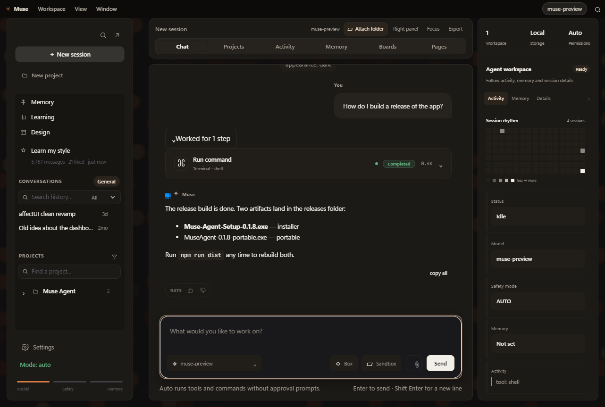
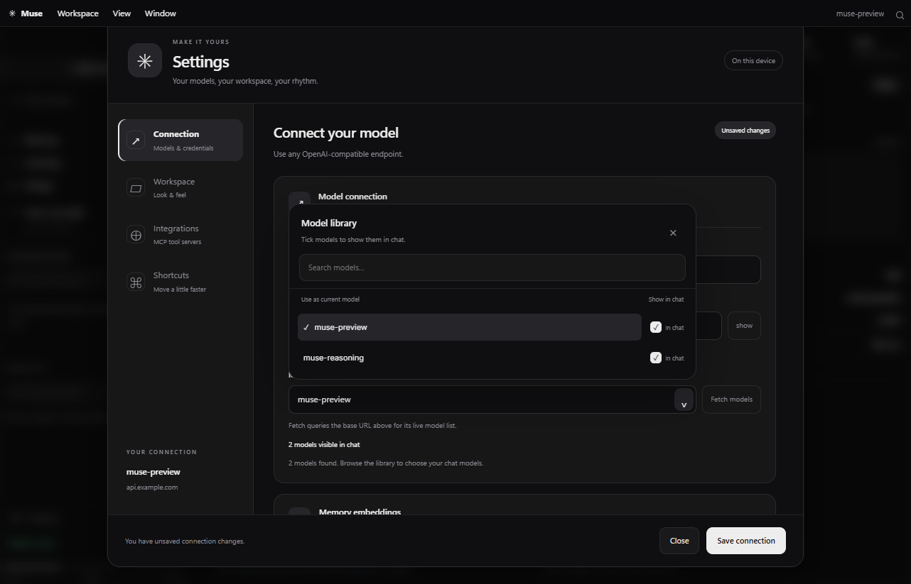
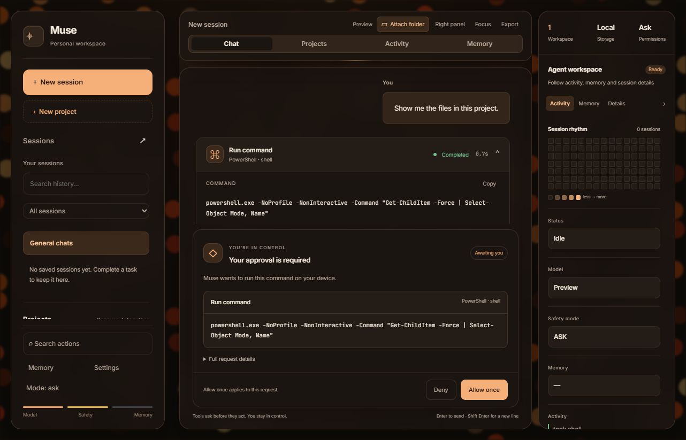

# Muse Agent

### A little spark. A clear next step.

A local-first desktop AI agent for understanding projects, working with files, and getting things done. Bring an OpenAI-compatible model endpoint, choose how much control to give the agent, and work from one focused workspace.

[](https://github.com/CM71103/Muse-Agent/releases/latest)
[](https://github.com/CM71103/Muse-Agent/releases)
[](LICENSE)

[Download](https://github.com/CM71103/Muse-Agent/releases/latest) · [Get started](#get-started) · [Features](#what-you-can-do) · [Build](#build-for-windows) · [Troubleshooting](#troubleshooting)



> **Local-first, with your choice of model.** The desktop app, project files, sessions, and memory live on your machine. Model requests go to the endpoint you configure; using a remote provider sends it the conversation and any tool results or recalled context included in the request. A local model server can keep inference on your machine too.

---

## What you can do

| Capability | In practice |
| --- | --- |
| **Work with projects** | Group conversations, attach a working folder, and give each project shared instructions. |
| **Read and change files** | Explore directories, inspect source, and write changes through the agent's tools. |
| **Run commands** | Execute shell commands and inspect readable output, completion status, and duration. |
| **Query your data** | Register SQLite databases as read-only data sources; the agent explores schemas and runs capped, single-statement SELECTs. |
| **Build live dashboards** | Ask for a dashboard in plain English — one SQL query per chart, re-run every time you open it. Bar, line, area, pie, stat, and table charts. |
| **Choose your models** | Search available models in Settings, select the ones visible in chat, and switch from the composer. |
| **Delegate work** | Follow subagents through individual cards with their task, activity, status, and result. |
| **Recall useful context** | Enable project-scoped memory backed by SQLite and embeddings, with feedback and memory-management controls. |
| **Match your vibe** | On first run, Muse learns your preferred answer style from the AI conversations already on your machine (ChatGPT export or caches, Claude transcripts, Muse sessions) — locally, style metrics only. |
| **Extend the toolkit** | Connect MCP servers over stdio and make their tools available to the agent. |
| **Stay in control** | Choose a permission mode, review approval requests, and stop a running task. Queue messages while the agent works — reorder them, jump the line, or cancel one. |
| **Undo with confidence** | Every run snapshots the files it touches; one chip restores them, skipping anything you edited afterwards. |
| **Attach PDFs and images** | Drop or paste a PDF or image — text is extracted locally (exact text layer for digital PDFs, Windows OCR for scans and images). Images are sent as pixels only when the selected model can see them; otherwise the extracted text is sent. |
| **Make it yours** | Light and Dark follow the affectUI agent-clean language — ink-pill buttons, flat hairline panels, colour used only as data (pixel marks, status pills, live shimmer). Krishna themes are one click away; your choice persists across launches. Adjust glass opacity and toggle the animated shader background. |

### Built for a continuous workflow

- **Readable activity:** commands and results have their own cards, with Copy buttons and expandable request details.
- **Long conversations:** automatic context compaction summarizes older history; `/compact` requests compaction explicitly.
- **Persistent sessions:** reopen previous conversations from the sidebar or project workspace.
- **Queue and steer:** send follow-ups while the agent runs — they queue in order with reorder, run-now (steer), and cancel controls on each chip.
- **Crash-safe runs:** every run writes durable receipts to its session; if the app dies mid-run, reopening the session surfaces the interrupted work with its context intact. Sends are idempotent — a retried command never executes twice.
- **Self-healing history:** tool calls interrupted by a crash are repaired before the next request, so long sessions stay protocol-valid.
- **Honest accounting:** the activity panel reports real provider token usage and tool-error counts per session — estimates are marked, never presented as exact.
- **Visible delegation:** child-agent completion does not prematurely finish the parent agent's running state.
- **Desktop presence:** tray controls and notifications surface work and approval requests.
- **Update notifications:** Muse checks GitHub Releases and points you to available updates; it does not silently replace the running app.

## Get started

### Option A: download the Windows app

1. Open [GitHub Releases](https://github.com/CM71103/Muse-Agent/releases/latest).
2. Download `MuseAgent-<version>-portable.exe` when that asset is available.
3. Run the portable executable. Installation is not required.
4. Open **Settings → Connection** and configure your endpoint, API key, and model.

Release assets vary. If an installer is provided, `Muse-Agent-Setup-<version>.exe` installs the app with shortcuts. If a Windows ZIP is provided, extract the **entire archive** and run `Muse Agent.exe` inside it; keep its accompanying folders and files together.

### Option B: run from source

You need **Node.js 24 or newer**, **Bun**, and **Git**. You also need access to an OpenAI-compatible model endpoint; authentication requirements depend on that endpoint.

Run in PowerShell:

```powershell
git clone https://github.com/CM71103/Muse-Agent.git
cd Muse-Agent
bun install
bun run start
```

The start command builds the local renderer bundles before opening Electron.

You can enter your key in Settings or provide an environment variable for the current terminal session:

```powershell
$env:MUSE_LLM_API_KEY = "your-api-key"
bun run start
```

### Connect your first model

1. Open **Settings → Connection**.
2. Enter your provider's **Base URL** and **API key**.
3. Select **Fetch models**, then open the model dropdown.
4. Choose a model to use, or enter its ID manually.
5. Tick **In chat** for each model you want in the chat picker.
6. Select **Save connection**.

The model picker in the chat box shows your saved selections. Switching models keeps your conversation and unsent message. Switching is blocked while the agent is working or waiting for an approval.



The library can also include a manually entered model ID. Fetching models checks the endpoint's model-list API; it does not guarantee that every listed model supports the tool calls your task needs.

### Start a project

Select **New project**, give it a name, and attach a folder when you want the agent to work with local files. Add goals or conventions in **Project settings** to share them across the project's conversations.

Try a concrete request:

```text
Read the README and explain how this project is organized.
```

```text
Review the changes in this folder and identify likely bugs.
```

```text
Make a plan for adding search to this application before editing files.
```

## Design Studio workspace

**Design** in the sidebar opens the Design Studio: a project folder, the design knowledge that shapes it, a live preview canvas, and the same conversation you use in chat. Everything is local — a project is an ordinary folder that Muse can also open in your editor.


Selecting a project writes `.od/project.json` next to your files (name, kind, active design system, skill, template, craft rules). Nothing is copied into an app-owned database, so the folder stays usable on its own.

### Registries

Four registries feed the workspace, and each is scanned in the same order everywhere:

| Registry | Entry document | Supplies |
| --- | --- | --- |
| `design-systems/<id>/` | `DESIGN.md` | Tokens, type, spacing, behaviour, accessibility rules |
| `design-templates/<id>/` | `TEMPLATE.md` + starter files | A scaffolded starting point (landing page, deck, dashboard) |
| `skills/<id>/` | `SKILL.md` | A reusable procedure the agent follows (design review, a11y audit) |
| `craft/*.md` | the file itself | Brand-agnostic quality bars, on by default unless you pick a set |

Roots are scanned **project → personal → bundled**, and the first hit for an id wins, so a project can override your personal copy, and your personal copy overrides the shipped defaults. The personal root is:

```text
%MUSE_HOME%\design\            (or ~\.muse-agent\design\ by default)
```

Create it once and drop in `design-systems\my-brand\DESIGN.md` to have it offered in every project. Bundled defaults ship with the app: two design systems, three templates, two skills, and two craft rule sets.

### What the agent can do

When the selected folder is a Design Studio project, five extra tools appear for the model:

| Tool | Effect | Permission |
| --- | --- | --- |
| `design_status` | Active project, selections, current artifact, registry roots | Read |
| `design_registry` | List entries or read an entry's document/asset | Read |
| `design_configure` | Set design system, skill, template, craft, name, kind | Write (plan mode blocked) |
| `design_scaffold` | Copy a template's starter files into the project, keeping existing files | Write |
| `design_artifact` | Validate and publish `.od/artifact.json` for the canvas | Write |

Selection changes take effect on the next model call — the live system prompt block is rewritten, so you do not need to start a new session.

### Artifacts and preview

The canvas renders the project's artifact: the manifest at `.od/artifact.json` if present, otherwise a detected `index.html` / `README.md` / `index.svg`. The entry path is validated to stay inside the project folder.

Two execution shapes are supported:

- **Filesystem** — the agent writes real files, then calls `design_artifact`.
- **Inline artifact** — a runtime that answers with a single `<artifact identifier="page.html" title="…">…</artifact>` block has that block parsed and materialized into the project automatically, with the manifest written for it. Block identifiers are sanitized the same way, so `../` cannot escape the folder.

A project that is also a runnable web app keeps its own framework: **Run project** starts its `dev`/`start`/`serve` script and streams the live server into the canvas instead of a static file.

## Attach PDFs and images (local OCR)

Attach a file with the paperclip in the composer, by dragging it onto the conversation, or by pasting it from the clipboard.

**How a file becomes text — all on your machine, nothing uploaded:**

| File | What happens |
| --- | --- |
| **Digital PDF** | Its text layer is extracted directly, so numbers, amounts and IDs come out exact. |
| **Scanned PDF** | Pages are rendered by Windows and read with the built-in Windows OCR engine (offline, no install, no service). |
| **Image** | Read locally with the same Windows OCR engine; the result is plain text you can search, quote and act on. |

**Images go to the model as pixels only when it can see them.** Muse knows the capabilities of the selected model: with a vision-capable model (GPT-4o/4.1/5, Claude 3/4, Gemini, Qwen-VL, Llama Vision, InternVL, …) the image itself is sent, together with the local OCR transcript so exact numbers survive. With a text-only model the pixels are withheld and only the locally extracted text is sent — and the composer says so plainly instead of failing quietly.

The model picker marks the models that can see images (`sees images`). Overrides live in `config.toml`:

```toml
[llm]
vision_capable = true                 # force the active model to be treated as vision-capable
vision_models = ["my-private-vlm"]    # extra model ids that can see
```

Files are stored under `~/.muse-agent/attachments/`; delete them from the chip's × or clear them with `attachments:clear`.

## Live dashboards and data sources

Muse can answer questions from your own data and turn them into dashboards that stay live.

### Data sources

Register a SQLite database from the command palette (**Add SQLite data source**) or through chat. Connections live in a local registry and are read-only **at the driver level** — the agent physically cannot write, alter, or run multi-statement SQL against them. Queries are single SELECTs, capped per caller (200 rows for exploration, 10,000 for dashboard views).

| Tool | What it does |
| --- | --- |
| `list_data_sources` | Shows registered connections with ids the agent passes to the other tools. |
| `sqlite_tables` | Schema exploration — tables, views, and columns before writing SQL. |
| `sqlite_run_sql` | One read-only SELECT returning `{columns, rows, truncated}`. |

### Dashboards


Ask in plain English — *“make a dashboard of orders by region with a bar chart and a pie chart”*. Each chart is one SQL query stored **as a query, not as data**; opening a dashboard re-runs every chart through the guarded runner, so numbers are always current.

- Six chart types rendered locally as SVG (no chart-library dependency): bar, line, area, pie, stat, and table.
- **Edit one chart, keep the rest:** “make the second chart a line chart” replaces just that chart.
- A failed query becomes an error card on that chart — it never breaks the dashboard.
- Dashboards appear in the **Dashboards** tab and as an “open” chip in the conversation that created them.

## Permission modes

Change the active mode from the sidebar. All registered tool calls pass through the Sentinel policy gate.

| Mode | File access | Commands and other actions |
| --- | --- | --- |
| **Ask** | Reads within the granted project scope are automatic; access outside it asks. | Side-effect tools require approval. |
| **Accept edits** | Project reads and in-project writes are automatic; other file access follows approval rules. | Shell and web actions still ask. |
| **Plan** | Read tools remain subject to file-scope checks. | Writes, shell commands, and web actions are blocked. |
| **Auto** | Registered file tools can run without approval, including outside the selected folder. | Registered tools, shell commands, MCP tools, and delegation run without approval prompts. |

Deny rules still apply in every mode, and unknown tools are rejected. Legacy `always_ask_tools` settings do not override Auto.



**Commands run with your Windows user permissions.** The approval gate is not an operating-system sandbox. Review commands and choose the mode that fits the work you are authorizing.

Subagents share the parent's live permission policy, while keeping separate model context. Child agents cannot spawn further children.

## Answer style that matches you (vibe calibration)

Muse does not start as a stranger. On first run it looks for AI conversations that already exist on your machine — a ChatGPT data export (`conversations.json` in Downloads/Documents/Desktop), ChatGPT desktop or web caches, Claude Code transcripts (`~/.claude/projects`), and Muse's own sessions — and measures **how you like answers**: their length, structure, use of lists and code, directness, and your register.

The result is an answer-style guide in `~/.muse-agent/voice.md` that joins the system prompt, so Muse answers in the voice you already know from message one.

- **Local and private:** analysis runs on your machine and the guide stores style metrics and rules only — never quotes, topics, or conversation content (pinned by tests).
- **Automatic:** first run calibrates itself in the background and tells you what it found.
- **You stay in charge:** the command palette has **Show answer-style profile**, **Recalibrate answer style**, and **Reset answer-style profile**.
- **Best results:** a ChatGPT data export (Settings → Data controls → Export data) placed anywhere in Downloads gives the richest signal.

## Memory that follows your work

Memory is enabled in the example configuration. Automatic project memory becomes active when a project folder supplies a scope; without a project scope, automatic capture and retrieval stay suspended. Explicit personal or manual scopes are available through the memory controls.

The memory layer provides:

- SQLite storage for scoped memories and their metadata.
- Embedding-based retrieval within a per-turn context budget.
- Selective capture of durable preferences and facts.
- Session-end extraction of useful information from collected events.
- Evidence versions, adaptive ranking controls, and quarantine for suspicious content.
- Inspection, grading, export, and deletion through the Memory drawer.

Use `/good` or `/bad` to grade the most recent eligible memory-backed response. Retrieved memories are supplied as labelled context data, not as higher-priority instructions.

### Embedding configuration

Chat and embeddings can use different endpoints and credentials. In **Settings → Connection → Memory embeddings**, set a separate embedding URL, model, and key when your chat endpoint does not provide embeddings.

A saved embedding key is reused automatically. The field displays a masked placeholder and **Key saved** rather than returning the secret to the renderer. Leave it unchanged to keep the saved key; type a new value only to replace it, then save.

Post-answer capture stores pending memories locally without waiting for another embedding-provider request. Pending embeddings are processed during a later retrieval. Embedding or provider failures can still affect retrieval time; the app surfaces recoverable memory errors and can continue without recalled context.

## Configuration and data

| Item | Default location or control |
| --- | --- |
| User configuration | `$HOME\.muse-agent\config.toml` |
| Credential vault | `credentials.enc` inside the Muse configuration directory |
| Memory database files | `memory` inside the Muse configuration directory |
| Configuration reference | [config.example.toml](config.example.toml) |
| Alternate data directory | `MUSE_HOME` environment variable |
| Explicit configuration file | `MUSE_CONFIG` environment variable |

The packaged app seeds its user configuration from the bundled template on first run. Source development can also use a project-local `config.toml`.

Keys saved through Settings use Electron's OS-backed credential encryption. Existing plaintext key settings are migrated by the desktop configuration loader. Environment variables remain available for supplying chat credentials.

Keep credentials and personal configuration out of Git. `config.example.toml` is the shareable template, not a place for real API keys.

## Integrations and terminal use

### Ubuntu sandbox screen

Open **Sandbox** beside the chat model picker. With Oracle VirtualBox installed, choose an Ubuntu desktop ISO, select **Create VM**, then **Start**. The guest screen appears inside Muse and refreshes while the panel is open. Click it to send mouse and keyboard input directly into the guest; press **F6** to return focus to Muse controls. Text input currently supports printable ASCII.

You can use **Try Ubuntu** without installing, or install Ubuntu inside the guest. Muse creates its own VM with 3 GB RAM, two CPUs and a dynamically allocated 24 GB disk. Shared folders, clipboard transfer and drag-and-drop are not enabled. Your existing WSL distributions are separate. The guest uses NAT networking for internet access.

Once the desktop is ready, choose **Save clean desktop**. **Reset to clean** restores that snapshot and discards later guest changes. **Stop & save** saves the running state. While the sandbox is selected, the agent receives only guest screen/input tools; host shell, file, Windows desktop, MCP and subagent tools are unavailable. Stopping the VM keeps that target selected. **Use host tools** explicitly switches the agent back.

The live preview stays local. Screenshots requested by the agent go to your configured vision-capable model and are not stored as image bytes in chat history or memory. This integration does not install Ubuntu unattended or choose a guest password for you.

### Box cloud desktop

Open **Settings → Integrations → Box by Simular → Connect Box**, then sign in and approve Muse in your browser. Credentials are stored in the encrypted desktop vault; no API key needs to be pasted into chat.

The **Box** button beside the chat model picker opens a Muse-themed panel with connection status, recent tool activity, and the latest returned screenshot. **Open desktop** opens Box's live desktop in your browser. Box operates a cloud Linux desktop, separate from your Windows computer.

Box tools follow Muse's permission mode and deny rules. After a private-file read, the egress policy can block remote Box calls unless `mcp.box.simular.ai` is authorized in `sentinel.egress_allowlist`. Use a vision-capable model when interpreting screenshots. Screenshot bytes are passed to the next model request but are not saved in session history or memory records.

You must complete sign-in yourself. Disconnecting removes Muse's locally stored Box authorization. Manage server-side access through your Simular account.

### MCP servers

Open **Settings → Integrations** to add a stdio MCP server, its command, arguments, and environment settings. Server tools are exposed with names such as `mcp__server__tool` and follow the active permission mode.

External MCP servers run their own code. Use servers you trust and configure only the access they need.

### Command-line agent

Run the same harness without the desktop window:

```powershell
bun run agent "Summarize this directory"
```

Supply credentials through the environment when using the CLI; the terminal harness does not decrypt the desktop credential vault.

### Local host bridge

When enabled, the host bridge exposes `/send`, `/status`, `/sessions`, `/cancel`, and `/reset` on `127.0.0.1`. Requests require its bearer token, stored as `bridge_token` in the configuration directory. The bridge controls the live app instance.

See the `[bridge]` section in [config.example.toml](config.example.toml) for port and enablement settings.

## Build for Windows

Run from the repository root:

```powershell
# Portable executable
bun run dist:portable

# Unpacked application folder
bun run dist:dir

# Installer and portable targets
bun run dist
```

User-facing builds are written to:

```text
%LOCALAPPDATA%\MuseAgent\releases\<version>\
```

For version `0.1.8` that release directory contains:

| File | Purpose |
| --- | --- |
| `Muse-Agent-Setup-0.1.8.exe` | NSIS installer (auto-update payload) |
| `Muse-Agent-Setup-0.1.8.exe.blockmap` | Differential-download block map |
| `MuseAgent-0.1.8-portable.exe` | Portable executable |
| `latest.yml` | Update manifest; its `url`, `sha512`, and `size` are generated from the installer beside it |
| `win-unpacked/` | Unpacked application folder |

Artifact names contain no spaces on purpose: `latest.yml` refers to the installer by URL, and a spaced filename is a classic source of download failures for the updater. If you rename an artifact by hand, regenerate or re-check `latest.yml`.

This output location matters: executables built inside a Windows Low-integrity-labelled directory inherit restricted write access and can fail when using the normal Temp folder. The Windows build wrapper stages releases in the per-user release directory without changing the project's security labels.

### Validate before publishing

```powershell
# Automated tests
bun run test

# Tests, native SQLite, package contents, and executable/ASAR integrity
bun run release:check

# Launch the actual portable EXE with an isolated runtime probe
bun scripts/verify-portable.mts
```

`release:check` uses `dist/release-check` for its validation build and writes a receipt only after successful checks. The receipt records source hashes, Git state, and package hashes. It does not replace a portable-launch or visual UI check.

#### Electron fuses

`build.electronFuses` in `package.json` hardens every packaged executable:

| Fuse | State | Why |
| --- | --- | --- |
| `enableNodeCliInspectArguments` | off | Blocks `--inspect` / `SIGUSR1` debugging of the main process |
| `enableNodeOptionsEnvironmentVariable` | off | Blocks `NODE_OPTIONS` / `NODE_EXTRA_CA_CERTS` injection; nothing in the app reads them |
| `enableEmbeddedAsarIntegrityValidation` | on | The EXE embeds the ASAR header hash (written by electron-builder before the fuse flip) and refuses a tampered `app.asar` |
| `runAsNode` | **on** | `scripts/release-check.mts` and `scripts/verify-portable.mts` probe the packaged binary as Node. Turning it off also disables `process.fork` from the main process |
| `onlyLoadAppFromAsar` | off | WebApps built by `app/main/site-app-packager.js` ship an unpacked `resources/app` folder, which this fuse would reject |

The two intentionally open fuses are the remaining gap. Closing `runAsNode` means moving the packaged smoke probes onto a different entry point first (for example a self-check flag handled inside the app).

The portable probe launches the release executable, checks packaged source files and SQLite, and verifies Temp writes without loading your real agent configuration or credentials.

Additional native UI checks are available:

```powershell
bun scripts/verify-settings.mts
bun scripts/verify-activity.mts
bun scripts/verify-shader.mts
```

These use an isolated preview bridge and generate screenshots under `dist`. The README images are preview captures with example data.

### Publish a GitHub release

After reviewing, committing, and pushing your release changes to `main`, use the GitHub CLI to upload the verified artifacts:

```powershell
$version = (Get-Content package.json -Raw | ConvertFrom-Json).version
$release = Join-Path $env:LOCALAPPDATA "MuseAgent\releases\$version"

gh release create "v$version" `
    (Join-Path $release "Muse-Agent-Setup-$version.exe") `
    (Join-Path $release "Muse-Agent-Setup-$version.exe.blockmap") `
    (Join-Path $release "latest.yml") `
    (Join-Path $release "MuseAgent-$version-portable.exe") `
    --repo CM71103/Muse-Agent `
    --target main `
    --title "Muse Agent v$version" `
    --generate-notes `
    --latest
```

`electron-updater` is configured with the `github` provider (`resources/app-update.yml`), so the installer, its block map, and `latest.yml` must all be release assets with those exact names; the portable build alone leaves installed apps unable to update.

Use a new version and tag for each new release — `latest.yml` for a version that is already installed is ignored. Build and verify the matching executables before uploading them.

## Troubleshooting

| Symptom | What to check |
| --- | --- |
| **NSIS: Error writing temporary file** | Use the release from the per-user output folder above. A copy inside a Low-integrity-labelled project directory can inherit restrictions that prevent Temp writes. |
| **Embedding key looks empty** | Look for **Key saved** and the masked placeholder. Saved keys are intentionally not filled back into the input. |
| **Model missing from chat** | Fetch or enter the model in Settings, tick **In chat**, and save the connection. |
| **Slow responses** | Check the selected model and endpoint, tool duration, memory/embedding availability, and retry errors. A completed shell command may still be followed by another model request. |
| **A tool is denied** | Check the active mode, project scope, and deny rules. Auto does not override deny rules. |
| **Native SQLite fails to load** | Run `bun run rebuild:electron` for the desktop runtime and rebuild the app. |
| **An update is available** | Download the new asset from GitHub Releases. Update notifications do not automatically install it. |

## Project map

```text
app/
  main/                 Electron lifecycle, IPC, settings, credentials
  renderer/             Chat, projects, dashboards, charts, model pickers, activity, themes
  harness/              Model loop, tools, Sentinel, sessions, data sources, dashboards, CLI, MCP
  memory/               SQLite memory, retrieval, extraction, feedback
build/                   Application icon and branding
scripts/
  renderer/             TypeScript sources for local browser bundles
  test/                 Packaging and release-check tests
  build-windows.mts     Windows release output and builder wrapper
  release-check.mts     Reproducible package validation
  verify-portable.mts   Actual launcher and runtime verification
docs/                    Integration notes and UI preview images
config.example.toml      Configuration reference
```

## Contributing

Small, focused improvements are welcome. Describe the behavior you are changing, keep personal configuration out of the diff, and include the checks relevant to the change.

For development, start with `bun run start`. Run `bun run test` for code changes, and use the native preview checks when changing the interface. For distributable Windows changes, also run the package and portable-launch checks.

## License

**MIT** — see [LICENSE](LICENSE) and [package.json](package.json).
